# DataPass V5, a guided tour

This page walks through everything new in V5, in the order you would try it, and lists every keyboard shortcut. Each part says where to click, what you should see, and what DataPass will never do on your behalf.

Everything below is on `main` (V5 final).

DataPass never runs your client's code, never deploys, and never calls an AI behind your back. AI help always goes through a request file you hand to your own AI, and whatever comes back is marked **AI-proposed**.

## Contents

1. [Where things are](#1-where-things-are)
2. [Every shortcut](#2-every-shortcut)
3. [Detach a dbt model](#3-detach-a-dbt-model)
4. [The Authority section](#4-the-authority-section)
5. [Multi-repo view](#5-multi-repo-view)
6. [Power Query data sample](#6-power-query-data-sample)
7. [DAG options](#7-dag-options)
8. [Guided tours: Learning and Interview](#8-guided-tours-learning-and-interview)
9. [Concept, decision and query cards](#9-concept-decision-and-query-cards)
10. [A tour prepared by your AI](#10-a-tour-prepared-by-your-ai)
11. [Explainer export](#11-explainer-export)
12. [Architect review](#12-architect-review)
13. [Studio demo](#13-studio-demo)
14. [Turning V5 features off](#14-turning-v5-features-off)

## Before you start

1. Build and install the extension (`npm run build`, then install the VSIX), reload VS Code.
2. Open the folder `tests/fixtures/v5/shop`: a made-up lakehouse with a PySpark ingestion notebook, bronze/silver/gold layers, dbt models `stg_orders` and `fct_orders`, a semantic model and a `.datapass/` manifest.
3. To see how DataPass behaves when facts are missing, open `tests/fixtures/v5/shop-bare` (same code, no manifest, decisions, volumetry or samples). Wherever a fact is missing, you should see a **hole** (what is missing, why, how to fill it), never a made-up value.

## 1. Where things are

| Place | What lives there |
|---|---|
| Activity bar, **DataPass** icon | the **Project**, **Git**, **Work** and **Galaxy** views |
| Activity bar, **DataPass Navigator** icon | the Navigator (the location you are at, its views, the Tours section) |
| Bottom panel, **DataPass Context** | the **Context** view: facts about the current location, the **Authority** section, tour explanations |
| Bottom panel, **DataPass Architecture** | the Architecture view |
| Secondary side bar, **DataPass** | **Navigator**, **Rail**, **AI** (the AI exchange), **Claude & Codex**, **Details**, **Airflow DAG** |
| Command Palette (`Ctrl+Shift+P`), type `DataPass:` | every command named in this page |

Which commands show in the palette depends on your DataPass mode: **DataPass: Switch Mode…** changes it, **DataPass: Customize DataPass Mode…** shows or hides single commands.

## 2. Every shortcut

These are all the keyboard shortcuts DataPass declares (`package.json`, `main`). Nothing else is bound.

| Keys | Command | When it works |
|---|---|---|
| `Alt+=` | DataPass: Larger Code Text (A+) | everywhere |
| `Alt+-` | DataPass: Smaller Code Text (A−) | everywhere |
| `Shift+Alt+P`, then `Up` | DataPass: Navigate Up (coarser level) | a DataPass navigation view is open (see below) |
| `Shift+Alt+P`, then `Down` | DataPass: Navigate Down (finer level) | same |
| `Shift+Alt+P`, then `Left` | DataPass: Previous View Here | same |
| `Shift+Alt+P`, then `Right` | DataPass: Next View Here | same |
| `Shift+Alt+P`, then `Home` | DataPass: Navigate to Project Root | same |
| `Shift+Alt+P`, then `Backspace` | DataPass: Navigate Back | same |
| `Shift+Alt+P`, then `Shift+Backspace` | DataPass: Navigate Forward | same |
| `Shift+Alt+P`, then `V` | DataPass: Pick a View Here… | same |

- The `Shift+Alt+P` chords work only while a DataPass navigation view is open, and never while you type in the editor, the terminal, a list or an input box. The setting `datapass.nav.globalKeys` (on by default) turns them all off.
- **DataPass: Reset the Code Text Size** has no key: run it from the palette.
- Inside the DataPass navigation view itself (not VS Code shortcuts, they only work while that view has focus): plain `Up` / `Down` go to a coarser / finer level, `Left` / `Right` to the previous / next view, `Home` to the project root, `Backspace` back. They are ignored while you type in a field or hold `Ctrl` or `Shift`. `Alt+Left` / `Alt+Right` are left to VS Code (back / forward).
- Inside the Navigator, when a guided tour is running, the number keys jump to a step and the mouse wheel moves through steps (see part 8).

## 3. Detach a dbt model

A dbt model can be **materialized** as a Fabric notebook (DataPass proposes the notebook; you review it). Later you may want the notebook, not dbt, to be the authority: that is **detaching**. DataPass records the decision, then tells you when the two drift apart. It never re-syncs on its own.

1. Materialize first, if the model is not yet: **DataPass: Materialize dbt Models as Fabric Notebooks (preview, then write)**. You see a preview; nothing is written before you confirm.
2. In the **Project** view, right-click the dbt model `fct_orders` and choose **DataPass: Detach dbt Model (the notebook becomes the authority)**. (From the palette, the same command asks you to pick the model.)
3. Read the confirmation and confirm. DataPass writes one file: the detach record under `.datapass/materialization/`, with the hashes of both sides.

   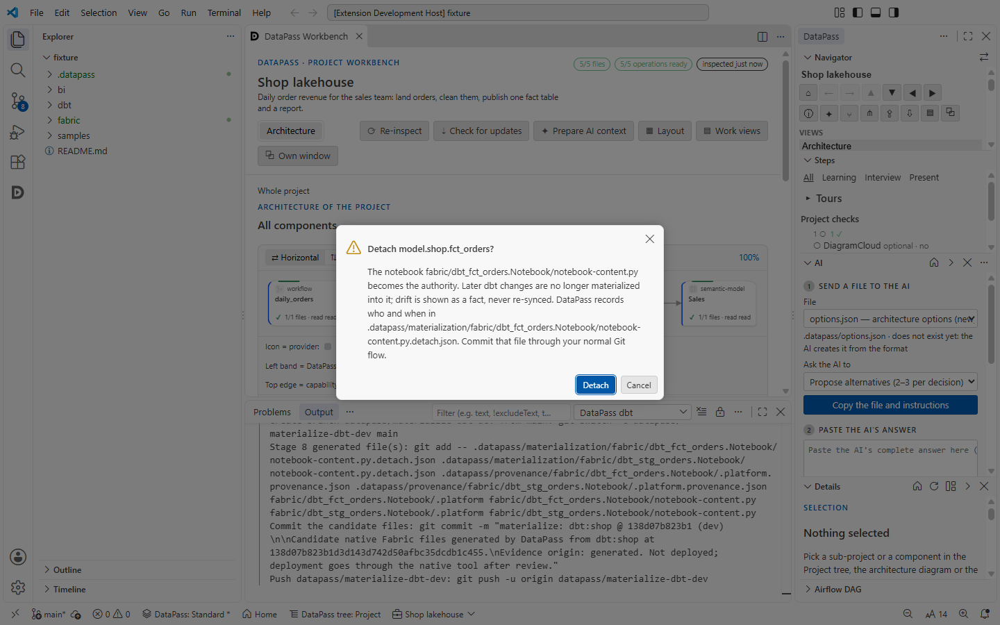

4. The model now carries a **detached** badge in the Project view, and the Context view shows the authority line.

   

5. Edit the notebook: the drift says **notebook edited**. Edit the dbt model too and commit: it says **both changed**. Other states are **in sync since detach**, **dbt changed** and **unknown** (DataPass could not read the dbt revision: a hole, never a guess). You can rename these words with `datapass.dbt.driftLabels`.

   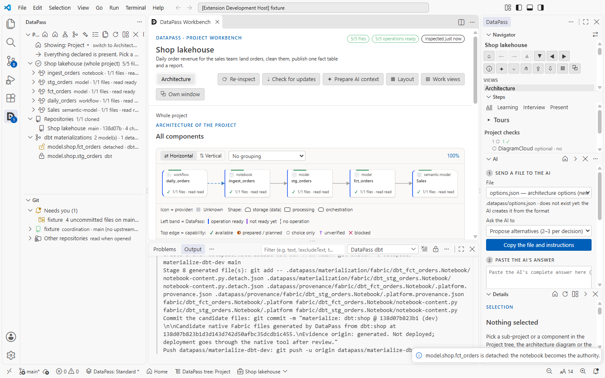

6. To re-attach, materialize the model again: you get a new proposal to review, never an automatic change.

**Spark job definition target.** The materialize command also offers a `spark-job-definition` target: a wheel skeleton and an entry script, proposed only, with a Git plan you run yourself. The wheel is not built and nothing is deployed. The default target stays the Fabric notebook.

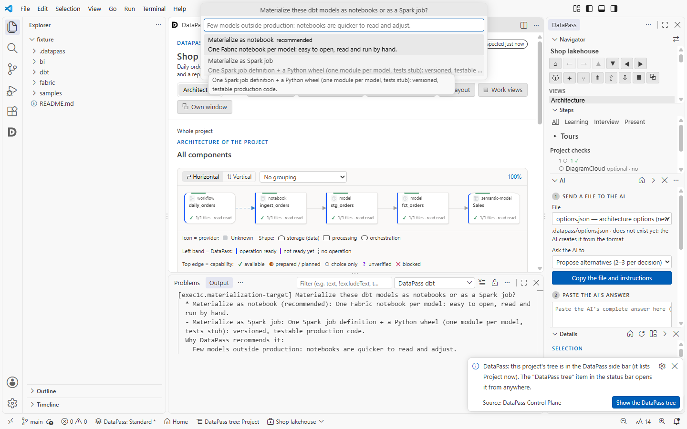
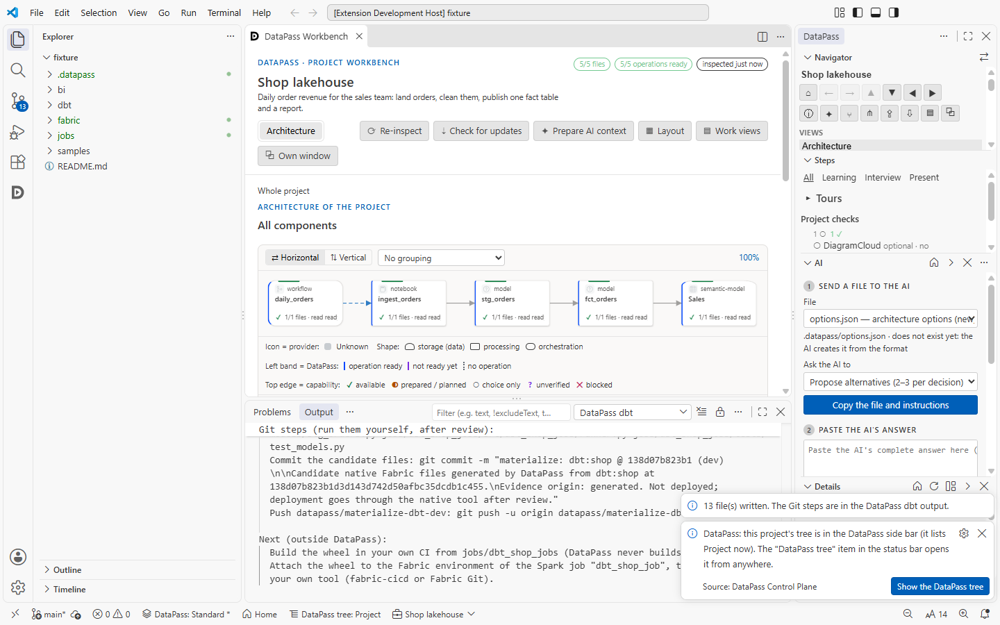

What DataPass never does here: run dbt, run the notebook, deploy, or write to Git.

## 4. The Authority section

Open the **Context** view (bottom panel) and its **Authority** section. For the current location it lists who may do what:

- **granted**: a local approval made by a DataPass action, for an exact file state, audience and scope;
- **claimed**: a label that only says "approved" or "reviewed" (from a file or an AI answer). A claim never counts as an approval, even when it names a reviewer.

The detached `fct_orders` shows its stamp, actor and date. When nothing was approved you read "no approval recorded", never "approved". The section is read-only: there is no approval button.

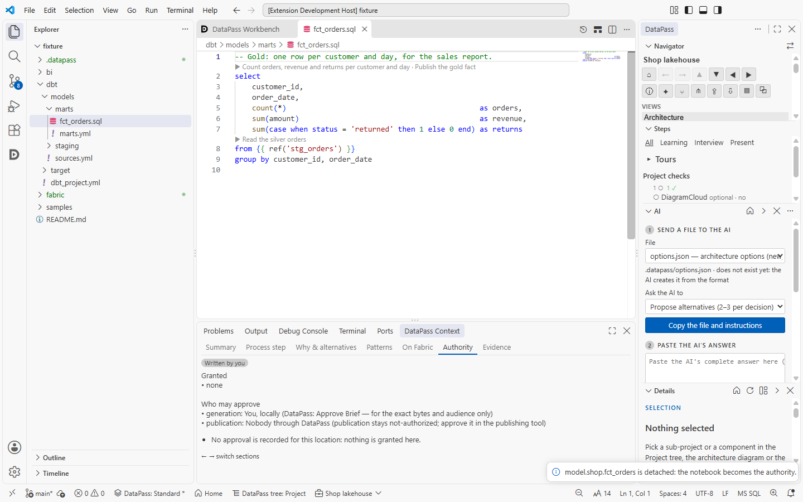

## 5. Multi-repo view

For a project spread over several repositories (the acceptance run builds `ingest`, `transform` and `bi`), DataPass reads the repository set once and adds two views to the Navigator. Go to a location in the Navigator and move between its views with `Shift+Alt+P` then `Left` / `Right`, or `Shift+Alt+P` then `V`:

1. **Repo lanes**: one lane of commits per repository (the last 100). A repository that is listed but not cloned shows as a hole, not as an empty lane.

   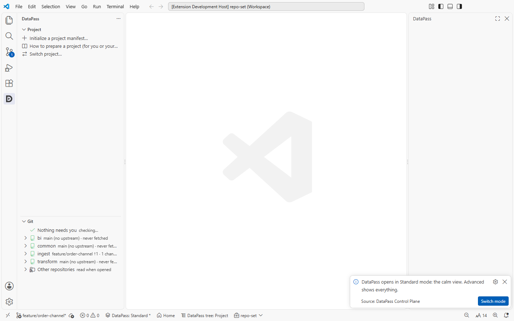

2. **Repo components**: a flow from each repository to the components its commits touched; the wider the link, the more commits. Titles and words are a setting (`datapass.repoHistory.labels`).

   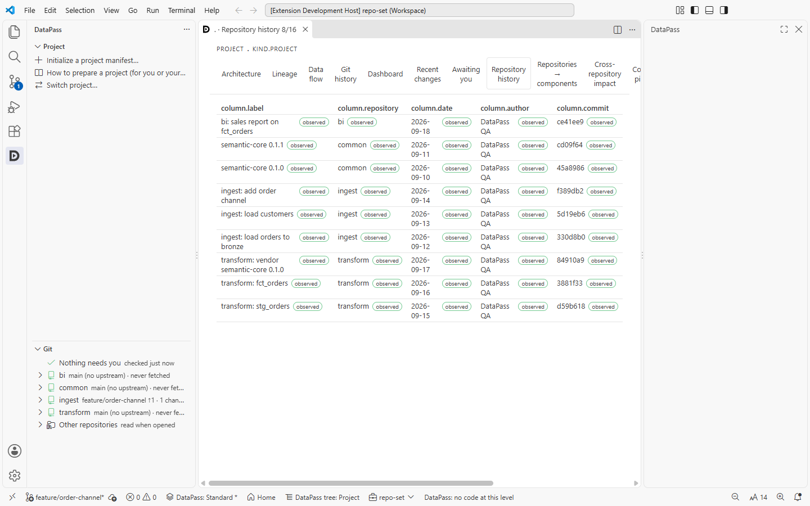

3. Pin drift (is the vendored Common copy behind the Common repository?) is checked by a non-blocking job in the merge-request pipeline, not in the editor. Without a Common clone it says "unknown", never "up to date".

DataPass only runs read-only Git commands here: no fetch, pull, checkout or push.

## 6. Power Query data sample

In the code-steps view of a Power Query or notebook file, each step has a slot for a small data sample:

1. Select a step, then run **DataPass: Data Sample for a Code Step**.
2. Choose where the sample comes from:
   - a local data file you pick, read by the **Data X-Ray** extension (only if it is installed), or
   - a sample request you copy for your own AI; paste its answer back and the rows are marked **AI-proposed**.
3. The rows appear under the step. Select another step: its own sample shows.

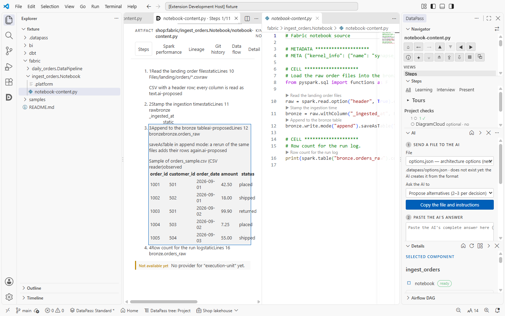

On `shop-bare` the slot shows a "no sample" hole, never generated rows. DataPass does not run the step's query.

## 7. DAG options

The **Airflow DAG** view (secondary side bar) has two buttons in its title bar:

- **DataPass: Switch the Airflow DAG Layout (Top-Down / Left-Right)** (setting `datapass.airflow.dagLayout`, default top-down);
- **DataPass: Choose Where the Airflow DAG View Opens**: the side bar, the bottom panel or an editor tab (setting `datapass.airflow.dagPlacement`, default side bar).

Shapes follow the operator family (sensor, transfer, SQL, Python…); you can change them with `datapass.airflow.dagFamilies`. An operator DataPass cannot classify gets a plain shape labelled "unclassified". Your choices are kept after a reload.

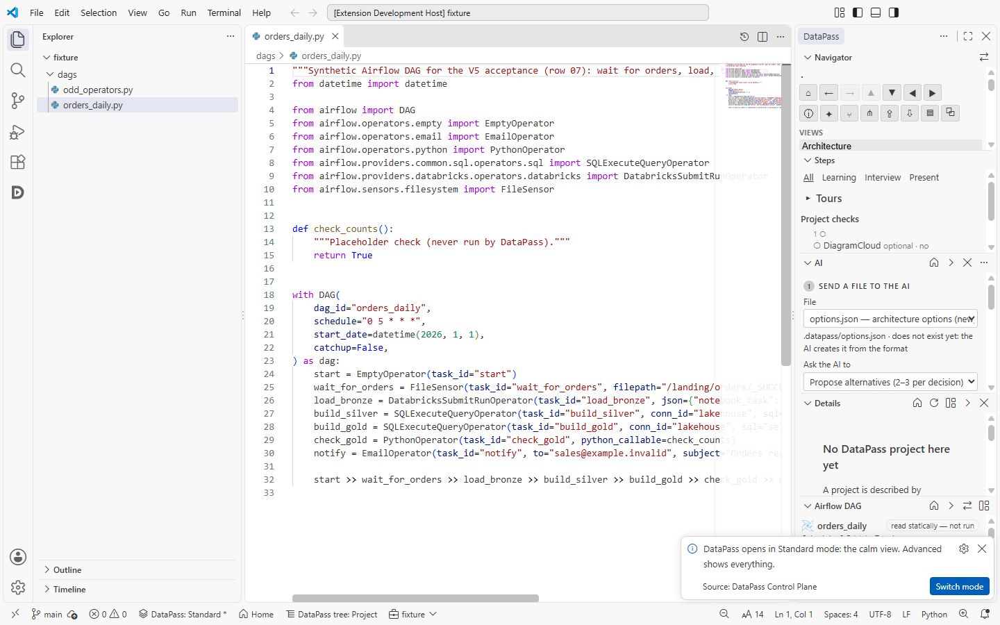
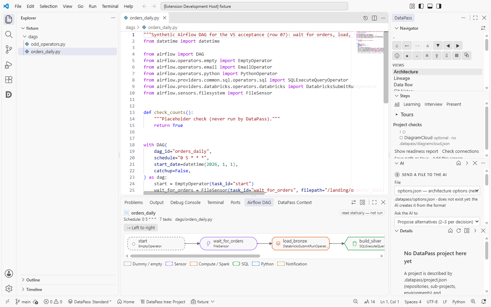

## 8. Guided tours: Learning and Interview

On `main` today: the Navigator's **Tours** section lists tours generated from the project (lineage and execution journeys) and your own tours from `.datapass/tours.json`. Use **DataPass: Pick a Tour…**, then **DataPass: Next Tour Step** and **DataPass: Previous Tour Step**.

Guided mode:

1. Run **DataPass: Guided Mode (Learning / Interview)…** (or use the mode switch in the Navigator).
2. **Learning** → the built-in tour **The whole picture** has five steps: arrive, live, change, run, trust. Move with the Next / Previous buttons, the number keys or the mouse wheel. The current step is highlighted on the mini-map and its explanation shows in a box (Navigator and Context view).

   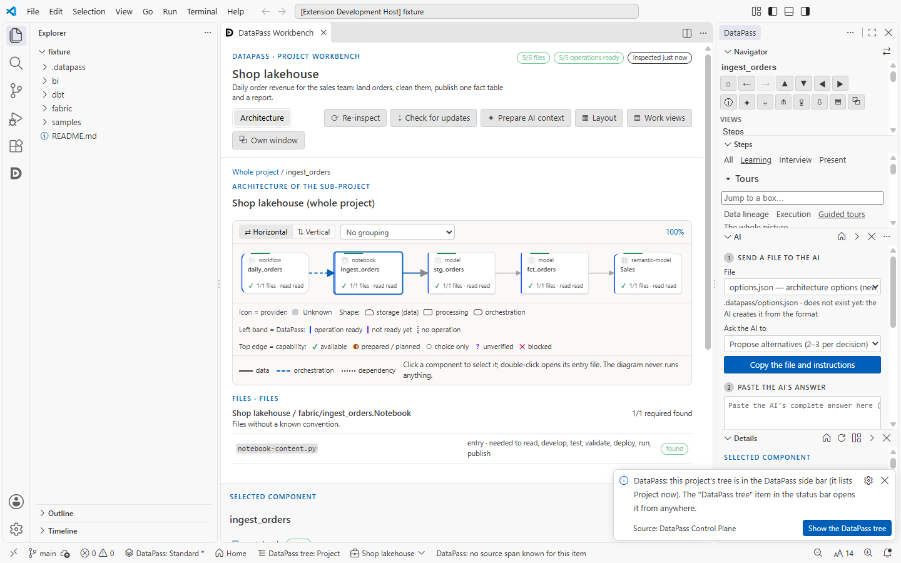
   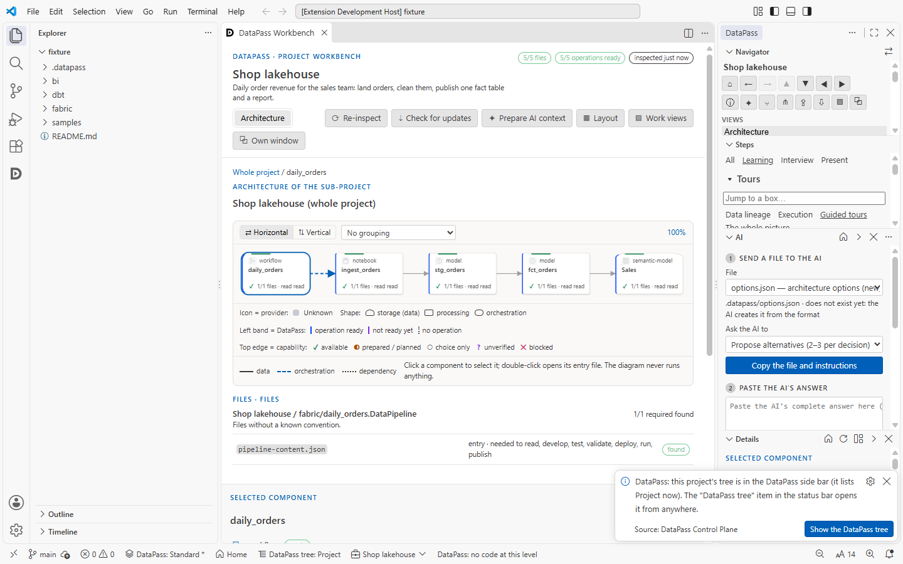

3. **Interview** → step 0 "Explain the project" (objectives, volumetry, platforms), then the whole picture, then the queries worth showing; each step has two or three questions to ask yourself. **DataPass: Interview Prep for This Project** will rank the notions the project really uses.

   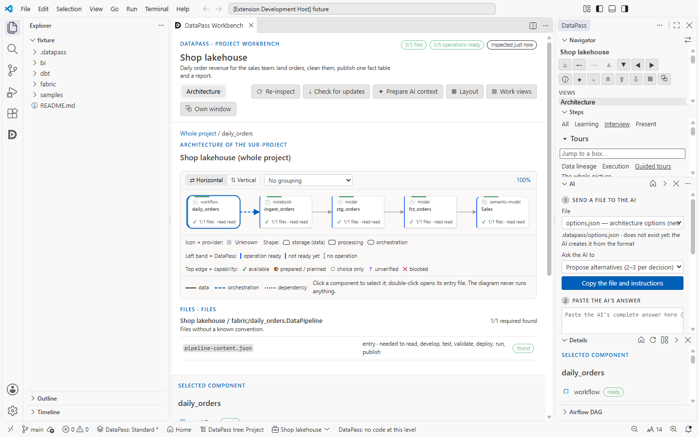

4. Walk through some views, then **DataPass: Save Current Path as Tour…**: the path is saved in `.datapass/tours.json`. **DataPass: Add This Screen to a Tour…** adds the current screen to a tour. **DataPass: Present Tour (Read-Only)** plays it with no edit controls.

   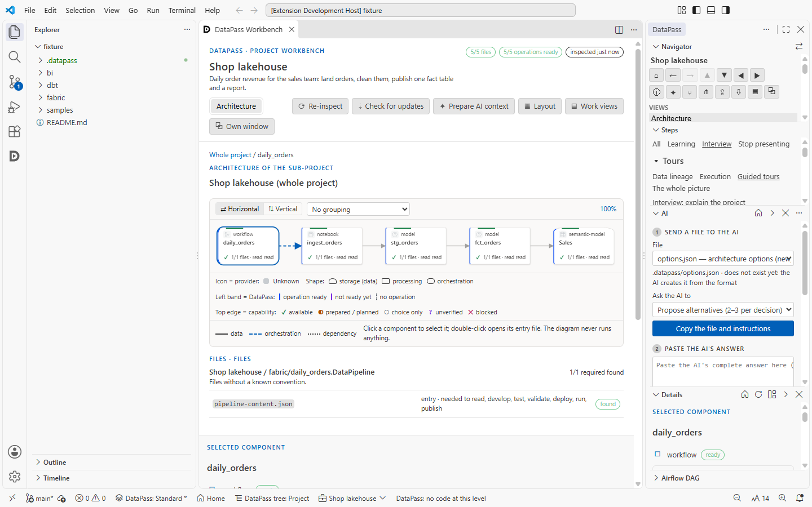

The built-in tours are built by **DataPass: Interview Prep for This Project** (its last entry shows them as `datapass.tour/1`). In Guided mode, picking **Learning** starts its built-in tour directly in the Navigator; picking **Interview** always starts the built-in tour at step 0 "Explain the project", even on a project with no `.datapass` folder (objectives and volumetry then show as holes). If you also saved your own tours for that mode, you pick which one to play. On `shop-bare`, objectives and volumetry are holes, and a step with nowhere to go (no orchestration) is shown as a hole step, not skipped.

## 9. Concept, decision and query cards

- **DataPass: Queries Worth Showing** (on `main`): the project's notable queries as cards, ranked by how well they show your skills in an interview (`datapass.pedagogy.queryShowcase.topN`, default 10).

  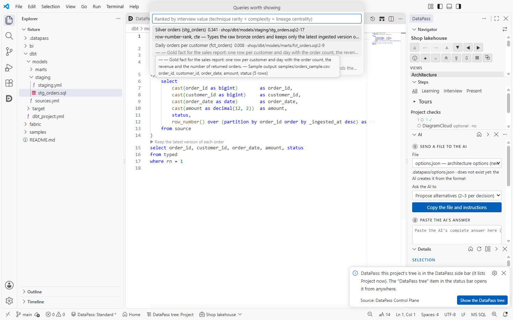

- **DataPass: Pattern Cards for This File**:
  - a **concept card** explains a pattern with an excerpt of your own code; click the excerpt to jump to it;
  - a **decision card** shows which option the project took and where. When no fact says it, the card asks the owner a question instead of guessing.

  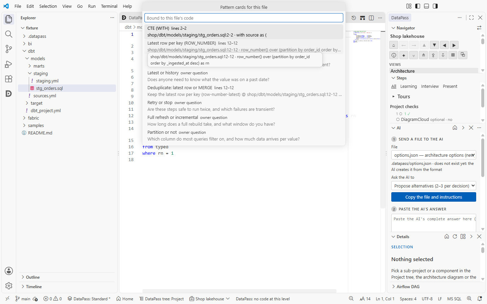
  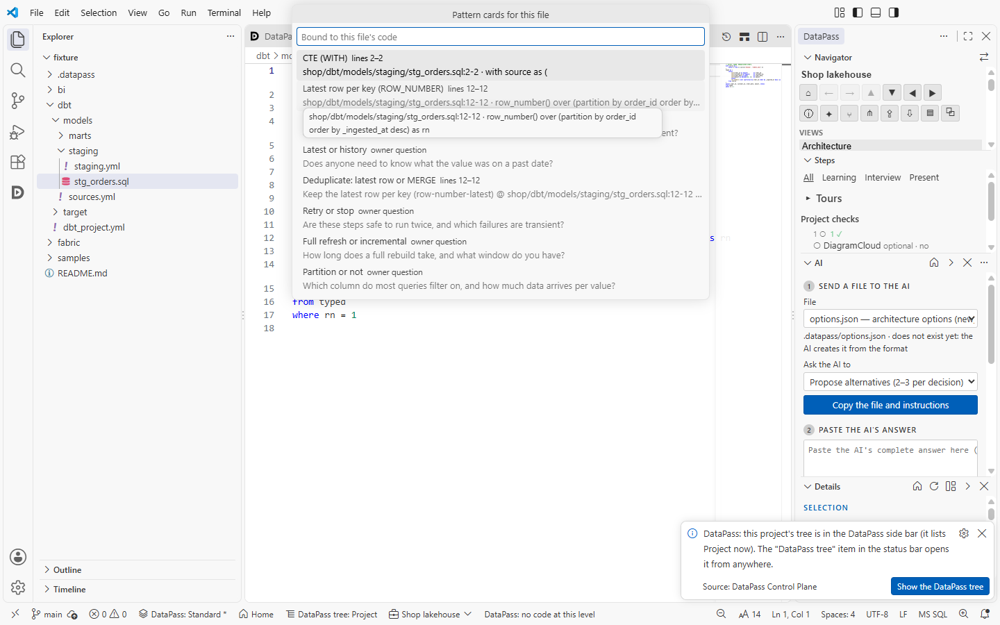

- **DataPass: Ask Your AI for Model Interview Answers** prepares a request for your own AI; the answers come back marked AI-proposed.

## 10. A tour prepared by your AI

1. Run **DataPass: Ask the AI for a Guided Tour…** and pick a topic (for example "BI and reporting"; topics are in `datapass.guided.ai.topics`).
2. DataPass writes a request with the project's real locations and views. Give it to your AI; there is no network call.

   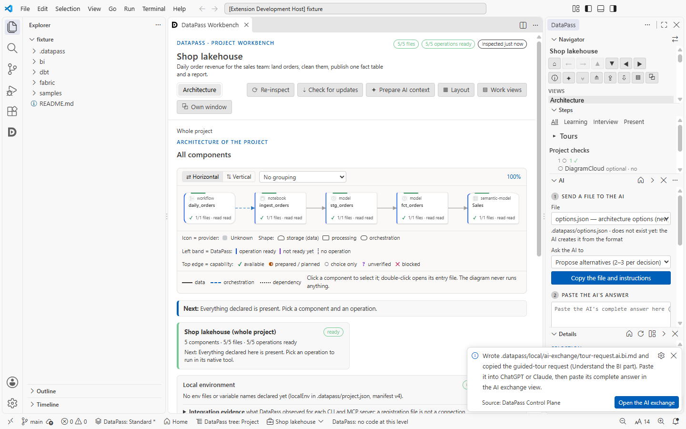

3. Import the answer through the AI exchange. The tour appears marked **AI-proposed**. A step that points to a place that does not exist becomes a hole step, never an invented screen.

   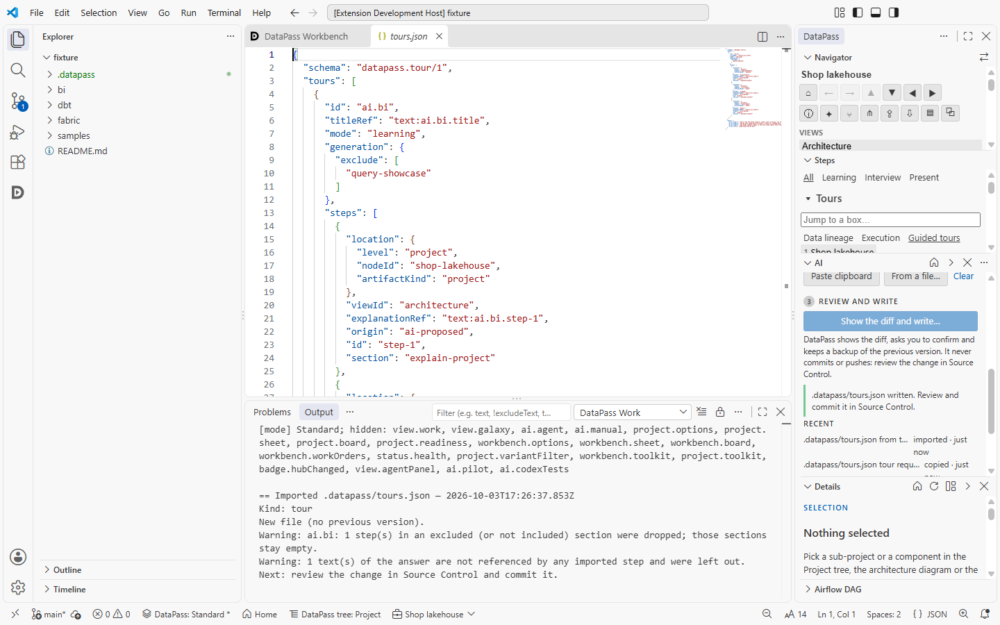

## 11. Explainer export

A single HTML page you can send to a client: architecture map, flows, lineage, readiness, next steps and recorded decisions.

1. Run **DataPass: Export Explainer Page (HTML)…**.
2. Choose the audience: **internal** (confidential items left out) or **public** (only items marked public).
3. The page is saved as `.datapass/explain/export-<date>.html`. Click **Open in Browser** or **Reveal File**. DataPass uploads nothing: you share the file yourself.

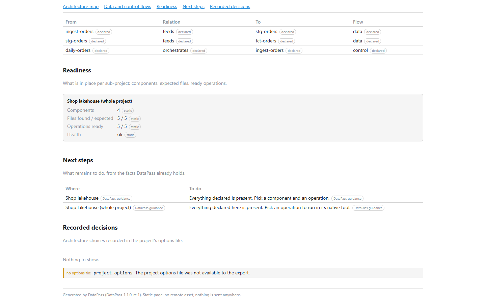

The page works offline (no web link inside). Its header shows the project, the Git commit, the date and the legend of where each fact comes from. Sections and their order are a setting (`datapass.explain.sections`), words too (`datapass.explain.labels`). On `shop-bare`, readiness and decisions show holes, never an empty chart dressed up as data.

**DataPass: Export Explainer Page with a Tour (HTML)…** adds a tour player to the page, so the reader can step through a tour without VS Code. The plain export asks too, with **No tour** as the default.

## 12. Architect review

DataPass offers an architect review (never runs one by itself) when:

- a change touches many components (more than `datapass.architectReview.largeChangeComponents`, default 5);
- the same check fails twice in a row (`datapass.architectReview.repeatedFailures`);
- you mark a readiness milestone done.

1. Accept the offer, or run **DataPass: Ask an Architect Review (AI exchange)…**: a request is prepared for your AI.
2. Run **DataPass: Import the Architect Review Answer…**: the answer shows in the Context view, marked AI-proposed. A citation of a file that is not in the project is flagged "unverified". The milestone stays reversible.

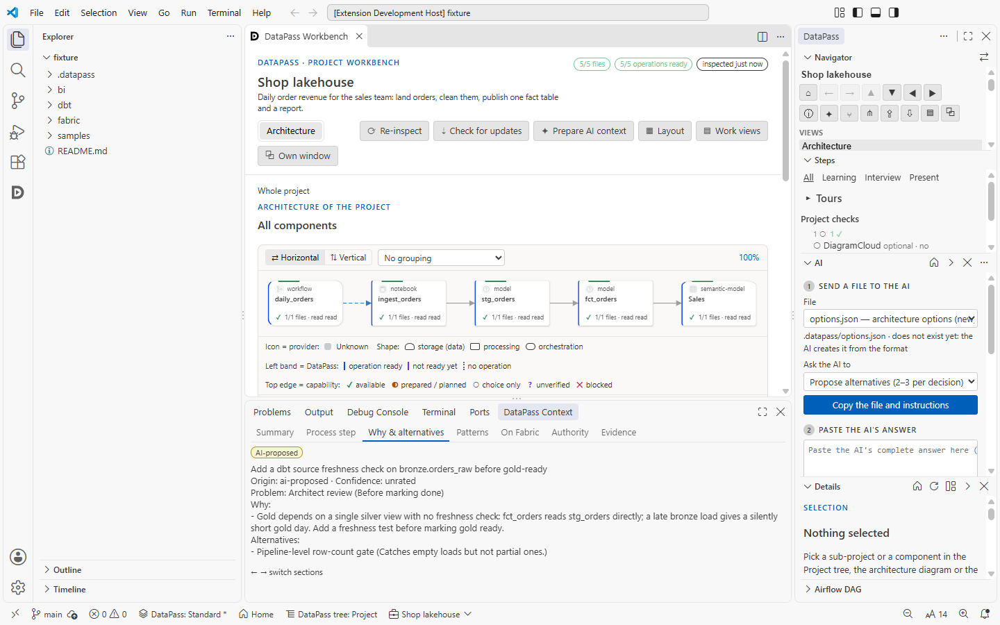

Turn the offers off with `datapass.architectReview.suggestions`.

**Next steps.** Every Navigator level has a **Next steps** table: what is still to do there, gathered only from facts DataPass already holds. Two new kinds of rows: gaps your AI reported through the exchange, and **stale evidence** (a verdict made on a file that has changed since). Each row jumps to where the work is.

## 13. Studio demo

Studio is a separate web app (repository `datapass-studio`) that opens a DataPass workspace export in the browser, with a DuckDB engine running in the page.

1. In `datapass-studio`: `npm run build:shell`, then serve the repository root on your machine only (for example `python -m http.server -b 127.0.0.1 8000`).
2. Open `/apps/studio-shell/dist/?workspace=examples/studio2/datapass-project.workspace.json`.
3. The **catalog** shows the shared DataPass views; open a SQL sheet and run a query on the sample table (queries never run on open).

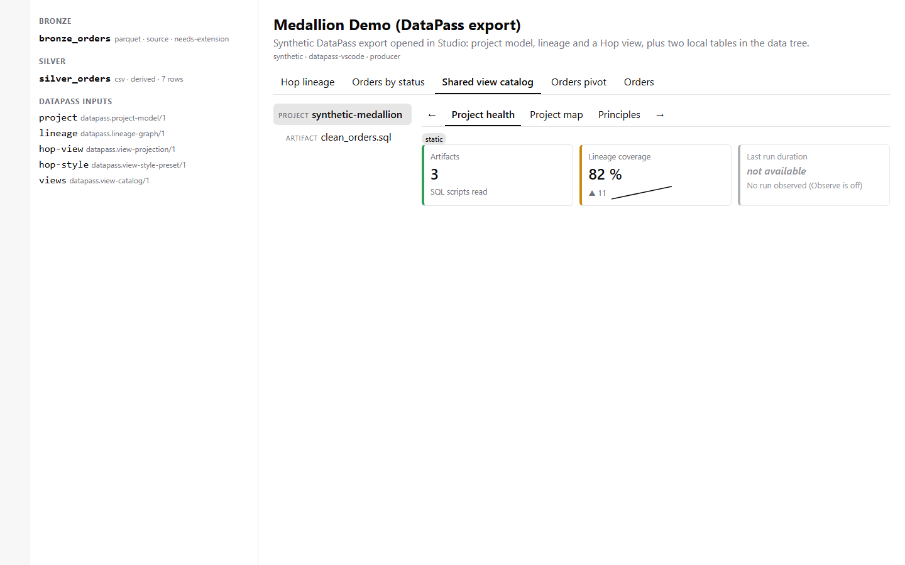
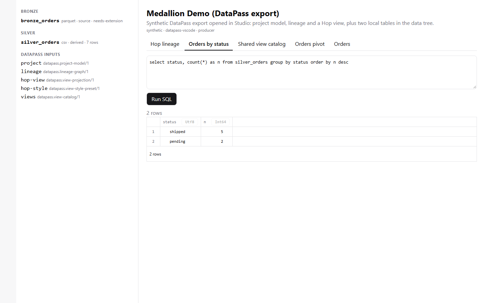

## 14. Turning V5 features off

Each V5 feature has its own switch; off means no UI and nothing computed.

| Setting | Turns off |
|---|---|
| `datapass.guided.enabled` | every guided tour, the Tours section and tour commands |
| `datapass.guided.generatedJourneys.enabled` | the tours generated from the project |
| `datapass.pedagogy.queryShowcase.enabled` | Queries Worth Showing |
| `datapass.guided.modes.learning.enabled`, `datapass.guided.modes.interview.enabled` | the Learning / Interview tours |
| `datapass.pedagogy.enabled` | all pedagogy cards and commands |
| `datapass.guided.ai.enabled` | Ask the AI for a Guided Tour |
| `datapass.architectReview.suggestions` | the architect review offers |

## Not in V5

Moved to V5.1: the FastAPI endpoint view, layouts per Navigator step, and the cross-repository impact view.
